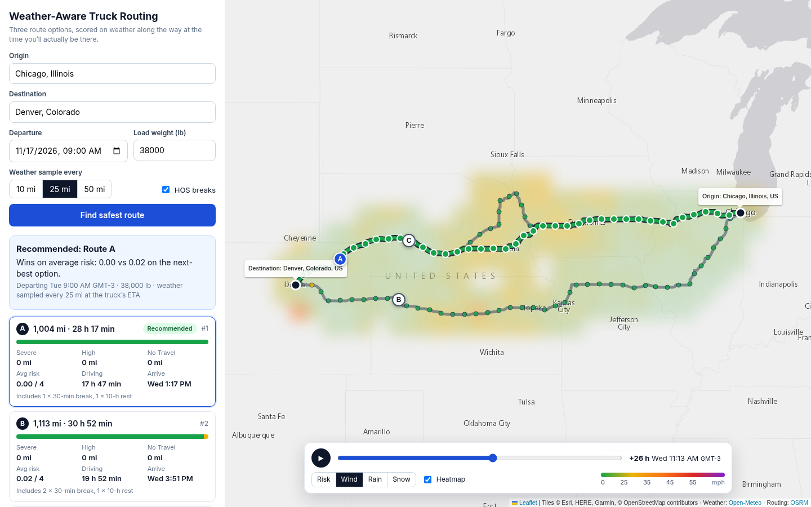

# Weather-Aware Truck Routing

A **React + Django** app that helps a truck driver pick the safest route between two places,
based on the weather the truck will actually meet along the way, the load it carries, and travel time.

- **Live demo:** _<hosted URL>_
- **Walkthrough video:** _<Loom URL>_



## What it does

| Requirement | How it is met |
|---|---|
| Origin, destination, departure, load weight | Form with geocoder suggestions (free text or `lat, lon` also accepted). |
| 3 route options from a routing API | OSRM alternatives; when OSRM returns fewer than 3, extra candidates are forced through via-points offset from the straight line and kept only if they are genuinely different and not absurd detours. |
| Weather every 10 / 25 / 50 miles at the truck’s ETA | User picks the interval. Checkpoints are placed every N road-miles (plus origin & destination); each gets a truck ETA and the forecast **for that hour**. |
| Risk from the provided rules | Wind / rain / snow tables + load rules, implemented verbatim in `backend/planner/domain/risk.py` and fully unit-tested at every boundary. |
| Recommend the best route | Ranked by the spec’s order: fewest Severe miles → fewest High miles → lowest average risk → shortest time. Routes with *No Travel* miles are a last resort. The UI states *why* the winner won. |
| Map with routes, checkpoints, risk, ETAs, summaries | Selected route is painted by risk level per stretch; every checkpoint is clickable (ETA, wind, gusts, rain, snow, reasons). Route cards show miles per risk level, average risk, driving time, trip time, arrival. |
| Corridor heatmap with a 0–48 h slider | Grid of forecast points around all routes; slider (and play button) scrubs 0–48 h after departure with smooth interpolation between hours. Layers: risk (with load rules), wind, rain, snow. Truck markers show where each route’s truck is at the slider time. |

## Architecture

```
frontend/  React 19 + TypeScript + Vite + react-leaflet
  src/components/   TripForm, PlaceInput, RouteCards, CheckpointTable, MapView, HeatmapLayer, ForecastControl
  src/lib/          heatCanvas (custom Leaflet canvas layer), geo, timeline, risk colours, formatting (+ vitest tests)
backend/   Django 6 + Django REST Framework (stateless, no database)
  planner/domain/   pure logic: risk rules, geometry, truck ETA/HOS, recommendation, heatmap corridor
  planner/services/ providers (OSRM, Open-Meteo, Photon) and the planning pipeline
  planner/tests/    pytest: rules, geometry/ETA, ranking, and API tests with every provider mocked
```

Request flow:

1. `POST /api/plan` geocodes both places, gets 3 routes, builds checkpoints with truck ETAs,
   fetches the weather for **all checkpoints of all routes in one batched call**, scores them and ranks the routes.
   It returns as soon as that is done, so the answer appears quickly.
2. The browser then calls `GET /api/heatmap/<plan_id>` for the 49 hourly frames of the corridor grid.
   The heavy data loads in the background and never blocks the recommendation.

Third-party APIs (all keyless, swappable through env vars):
**OSRM** for routing, **Open-Meteo** for hourly forecasts (many locations per request), **Photon** (OpenStreetMap) for geocoding, Esri Light Gray basemap tiles.

## Key decisions

**Truck ETAs.** OSRM times are for cars, so each road segment is capped at 65 mph. Optionally (on by default)
simplified FMCSA hours-of-service are applied: a 30-min break after 8 h of driving and a 10-h rest after 11 h.
This matters for weather. On a 1,000-mile trip the second half is driven the next day, and that is the forecast that counts.

**Forecast semantics.** Open-Meteo reports precipitation as the total of the *preceding* hour, while wind is instantaneous.
Rain and snow therefore use the hourly bucket the ETA falls in (in/hr), and wind is linearly interpolated between hours.
Rain = `rain + showers`. Snow = `snowfall` in inches. Wind = sustained 10 m wind in mph (gusts are shown but not scored, since the spec’s thresholds are for wind).

**Risk boundaries.** The spec’s ranges share endpoints (`0.10–0.25`, `0.25–0.50`). A value equal to a lower bound
belongs to the higher level (0.25 in/hr is High). For “No Travel” the spec says `>1.00` and `>3.0`, so exactly 1.00 in/hr rain is still Severe.
Load rules: ≥55 mph is No Travel for any load. 45–54 mph with >30,000 lb is No Travel. 35–44 mph with >40,000 lb is Severe.
A checkpoint’s risk is the worst of wind, rain, snow and the load rule.

**Miles per risk level.** Each checkpoint owns half the gap to its neighbours, so every road mile is counted once.
The map paints the selected route with exactly those stretches, so what you see matches the numbers.

**Recommendation.** Routes are ordered lexicographically by the spec’s criteria, with No Travel miles ranked first
(a route you must not drive cannot be the safest). Mile comparisons use a 1-mile tolerance, which is below the sampling resolution,
so rounding noise never forces a much longer route. If every option crosses No Travel weather, the app says so and suggests delaying departure.

**Heatmap performance.** The corridor is a grid of about 200–350 points within 20–60 mi of any route.
Grid spacing adapts to trip length. It is drawn by a ~100-line custom Leaflet layer on a single `<canvas>`
(`src/lib/heatCanvas.ts`) with a GPU CSS blur for the heatmap look. Moving the slider only lerps two pre-computed frames and repaints a few hundred rectangles.
There are no DOM nodes and no React reconciliation, and the route layers are memoised, so playback runs at display frame rate.
Labels sit in a pane above the heatmap so cities stay readable.

**Caching & resilience.** Provider responses are cached (file-based cache shared by all gunicorn workers).
HTTP calls retry with backoff on 429/5xx. Provider failures become clear 502 messages, and bad input becomes 400/422 with the offending field highlighted in the form.

## Run locally

Requirements: Python 3.12+, Node 20+.

```bash
# API
cd backend
python -m venv .venv && . .venv/bin/activate
pip install -r requirements-dev.txt
python manage.py runserver 8000

# Web (in another terminal), proxies /api to :8000
cd frontend
npm install
npm run dev            # http://localhost:5173
```

Production-like single process (Django serves the built SPA through WhiteNoise):

```bash
cd frontend && npm run build
cd ../backend && DJANGO_DEBUG=0 gunicorn config.wsgi:application --bind 0.0.0.0:8000 --workers 2 --threads 8
```

Tests:

```bash
cd backend && pytest          # 56 tests: rules, boundaries, ETA/HOS, ranking, API (providers mocked)
cd frontend && npm test       # vitest: heat scales, timeline, geometry
```

## Deploy

The repo ships a multi-stage `Dockerfile` (it builds React, then serves everything from Django and gunicorn) and a Render blueprint (`render.yaml`):
Render → New → Blueprint → pick this repo. Any Docker host works (Fly.io, Railway, Cloud Run).
Environment: `DJANGO_SECRET_KEY`, `DJANGO_DEBUG=0`, optional `DJANGO_ALLOWED_HOSTS`, `OSRM_URL`, `OPEN_METEO_URL`, `PHOTON_URL`.

## Trade-offs and limitations

- **Public demo servers.** The OSRM demo server and the free Photon and Open-Meteo tiers have rate limits and no SLA.
  In production I would use a truck-aware router (bridge heights, hazmat, truck restrictions) such as HERE or a self-hosted OSRM/Valhalla with a truck profile, plus a paid weather plan.
- **OSRM car profile.** Routes are car-legal roads. The 65 mph cap approximates truck speed but does not model truck-only restrictions.
- **Via-point alternatives** are a pragmatic way to guarantee 3 options when the router offers fewer. They are filtered for overlap, detour ratio and U-turn artefacts, but they are not optimal alternatives.
- **Forecast horizon.** Departure is limited to the next 7 days. The heatmap covers 0–48 h after departure as the spec asks, so long trips continue beyond the slider range, although checkpoint risk always uses the forecast at each ETA.
- **Times** are shown in the browser’s time zone.
- **Stateless.** Plans live in the cache for 1 hour, which is enough for the heatmap request. There is no database because nothing needs to be persisted.

## API

`POST /api/plan`
```json
{ "origin": "Chicago, IL", "destination": "Denver, CO", "departure": "2026-11-18T08:00:00-06:00",
  "load_lbs": 38000, "interval_mi": 25, "hos": true }
```
Returns `plan_id`, geocoded endpoints, 3 `routes` (geometry, distance, driving/trip time, arrival, HOS stops, summary, checkpoints with ETA, weather and risk) and the `recommendation` with its reason.

`GET /api/heatmap/<plan_id>` returns corridor grid points, cell size, and 49 hourly frames for `risk`, `wind`, `rain` and `snow`.

`GET /api/geocode?q=` returns place suggestions. `GET /api/health` is the health check.
